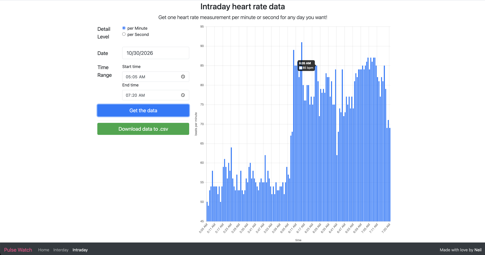
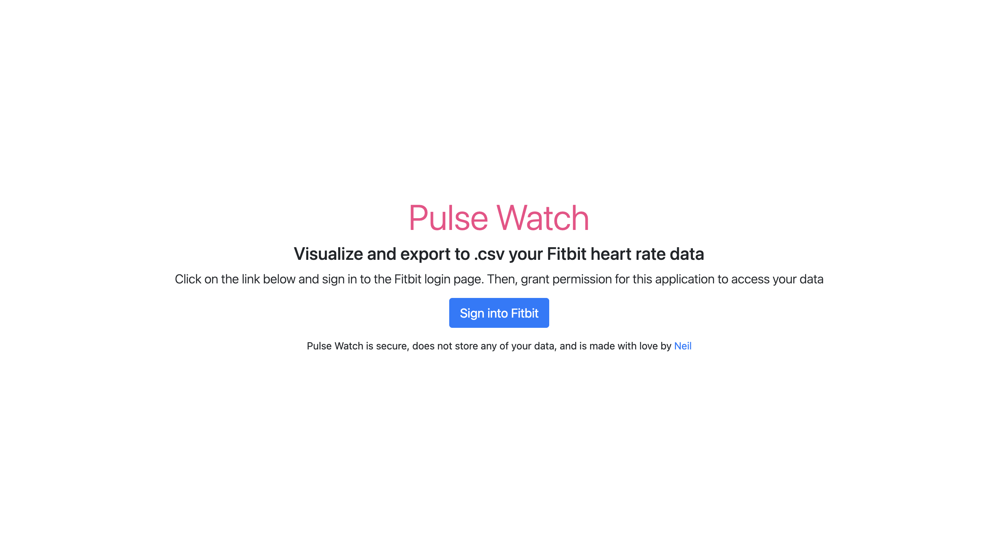
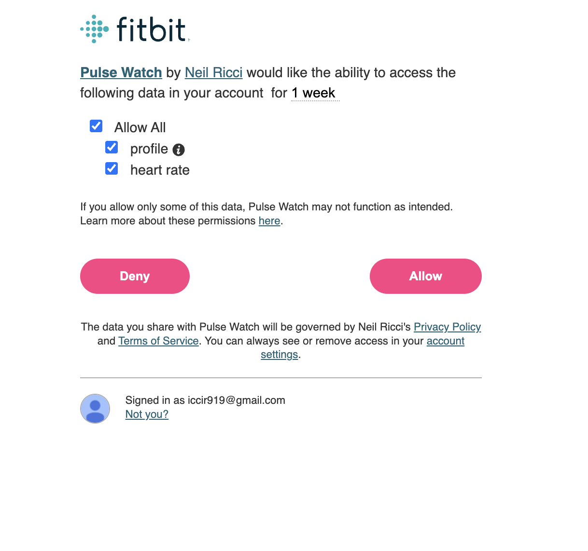
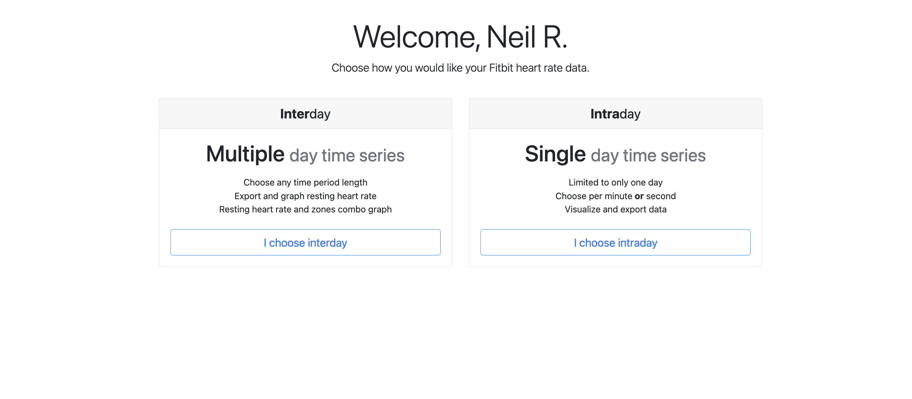
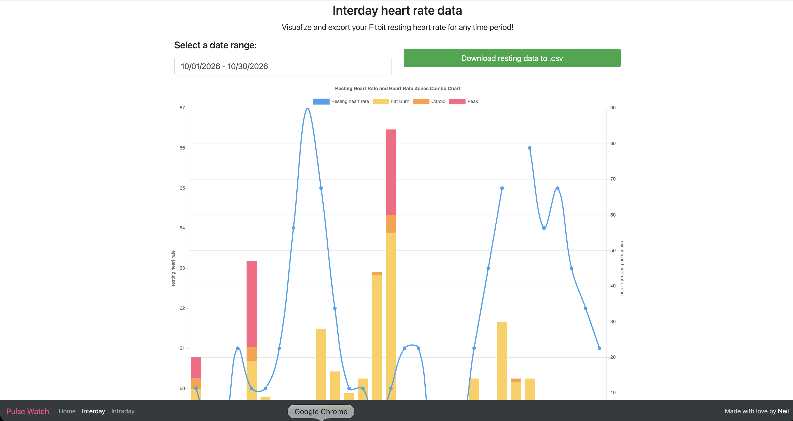

# Pulse Watch

> **Status: no longer working.** Pulse Watch was built on the Fitbit Web API, which Google shut down on November 2, 2026. The live demo can no longer connect to Fitbit accounts. The code stays here as a record of the project.

Pulse Watch was a small web app that let people easily visualize and download their own Fitbit heart rate data. You signed in with Fitbit, picked a day or a date range, saw your heart rate on a chart, and downloaded it as a .csv file you could keep or analyze however you wanted.

[Visit the retired app](https://iccir919.github.io/pulseWatch/public/index.html)

It was my first real coding project, built in 2018 after Hack Reactor. At its peak it had over 100 monthly active users, mostly people who wanted their detailed heart rate data in a form Fitbit's own app didn't offer.

## Screenshots

These were taken on October 30, 2026, a few days before the Fitbit Web API was turned off.

**1. The landing page.** One button to sign in with Fitbit.

**2. Fitbit's permission screen.** Users granted Pulse Watch access to their profile and heart rate data for one week.

**3. The dashboard.** After signing in, users picked one of two views.

**4. Intraday view** (the chart at the top of this page). Heart rate for a single day, per minute or per second, with a .csv download.

**5. Interday view.** Resting heart rate and time in heart rate zones across any date range, with a .csv download.

## What it did

- Connected to a user's Fitbit account through the Fitbit Web API (OAuth)
- **Intraday view:** charted detailed heart rate readings for a single day
- **Interday view:** charted resting heart rate across a date range
- Exported either view to a .csv file
- Ran entirely in the browser: no server, no accounts of its own, no stored health data

## Why it stopped working

Google acquired Fitbit and replaced the Fitbit Web API with the new Google Health API. Official support for the old API ended on September 30, 2026, and it was turned off on November 2, 2026.

The new API is not a drop-in replacement. As of this writing, Google is not onboarding new projects, and when it does, health data falls under Google's "restricted" OAuth scopes, which require a full app verification and security review. That is a big hurdle for a small, free tool like this one.

## What's next

I'm exploring a rebuild that doesn't depend on a live API at all: you export your own data from Google Takeout, drop the file into the app, and everything is processed in your browser. Your health data never leaves your device.

If that interests you, star or watch this repo for updates.

## Tech

- HTML, CSS, JavaScript, jQuery, Bootstrap
- Chart.js for the charts
- Hosted as a static site on GitHub Pages (Express was only used to run it locally)
- Fitbit Web API (retired)

## License

MIT. See [License.txt](License.txt).